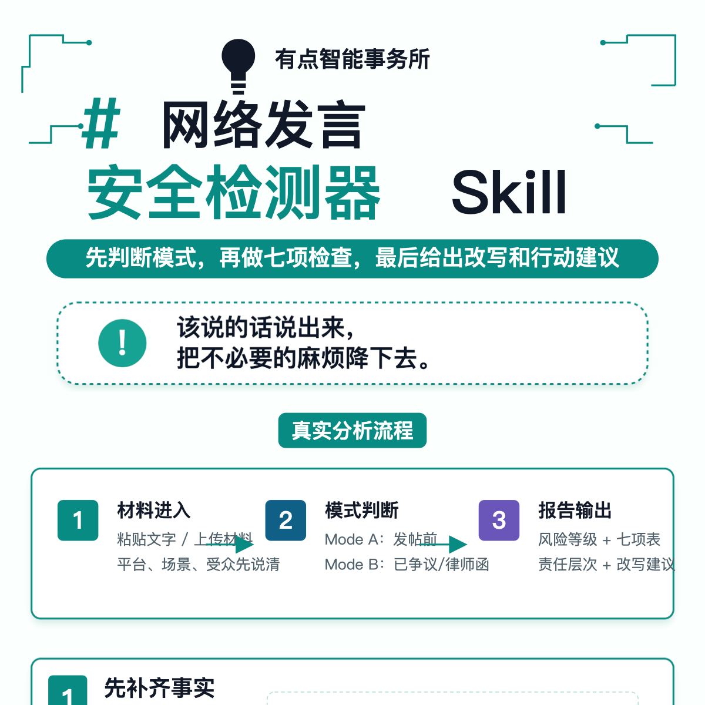
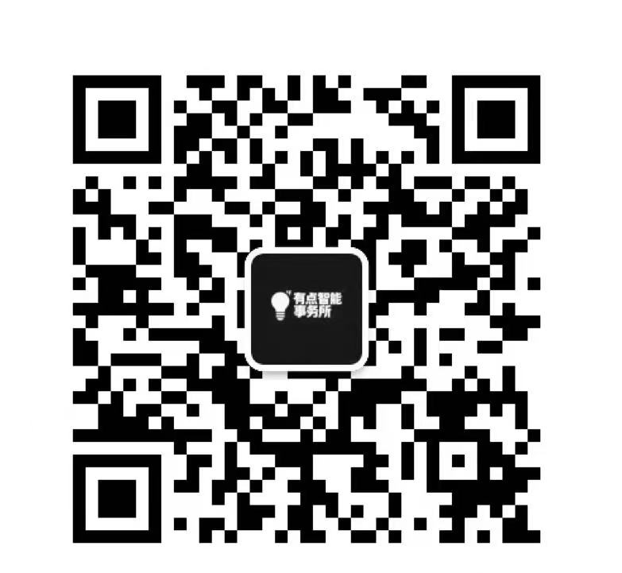

<div align="center">


# Online Speech Safety Simulator

## 网上锐评对线安全模拟器

面向 founder、自媒体、AI 从业者、独立开发者、早期创业团队和高强度网上冲浪选手的网络发言风险检测 Skill。

发帖前先自查，吵架前先降火，被冲、被告、收到律师函后先判断风险。

<p>
  
  
  
  
  
  
  
</p>
</div>

---

当前版本：`v1.0.0`。

这是一个面向 founder、自媒体、AI 从业者、独立开发者、早期创业团队和高强度网上冲浪选手的网络发言风险检测 Skill。

它用于在中文互联网场景下，对拟发布内容、争议发言、避雷帖、消费差评、群聊互骂、职场吐槽、热点评论、维权求助、挂人曝光、被律师函或被起诉后的材料进行风险判断。

它不会鼓励你忍气吞声，也不会教你如何网暴别人。它做的事情更现实一点：在尽量保留合理表达空间的同时，帮你识别哪些话容易引发名誉权、隐私权、肖像权、侮辱、诽谤、行政处罚甚至刑事风险。

简单说，就是让你在网上冲浪之前，先看看自己是不是已经把冲浪板改装成了刑事案件启动器。人类表达欲很珍贵，但有时候也确实很会自爆。

## 为什么做这个项目

现在各行各业都开始做自媒体。

founder 要发观点，开发者要写产品日志，AI 从业者要评论行业热点，律师、投资人、创作者、博主也都在持续输出。

表达变多之后，风险也会跟着变多。

很多时候，真正出问题的并不是正式声明，而是那些看起来很随手的场景：

- 朋友圈吐槽前同事；
- 小红书发避雷帖；
- 微博评论热点人物；
- 业主群里骂邻居；
- 消费差评里带上老板个人信息；
- 职场维权时公开聊天记录；
- 被人骂了以后激情回骂；
- 转发爆料时顺手补一句"这人就是骗子"；
- 给对方贴"诈骗犯""小三""人渣""渣男""恶臭"等标签。

很多人以为，只要自己说的是事实，就一定安全。

但网络发言的风险从来不只看"真假"。

它还要看你有没有证据、是否使用侮辱性措辞、是否公开他人隐私、有没有使用对方照片、传播范围有多大、是否引导围攻、有没有跨平台扩散、是否已经达到刑事案件中的传播门槛。

更麻烦的是，有些场景本身是正当的，比如消费维权、劳动争议、公益监督、公开求助。

但一旦措辞失控，维权就可能变成诽谤；曝光就可能变成网暴；索赔话术不当，甚至可能被对方反咬成敲诈勒索。

这个项目想解决的不是"让大家别说话"。

恰恰相反，我更希望它帮助普通表达者把真正想说的事情说清楚，把不必要的法律风险降下来。

你可以批评一件事，可以表达不满，可以维权，可以反驳，可以监督，也可以说"我不认可"。

但尽量不要一边说自己是在维护权利，一边把对方姓名、照片、电话、住址、工作单位、家属信息和几句刑法级别的指控一起打包发出去。互联网已经够乱了，不需要每个人都亲自给自己添一份诉讼套餐。

## v1.0.0 能做什么

当前版本支持两种模式，并提供一个三问自查决策树。

### 模式 A：发帖前自查

适合内容尚未发布前使用。

你可以把准备发的微博、小红书、公众号、朋友圈、群聊发言、差评、避雷帖、维权帖、热点评论或反驳内容交给 Skill 检查。

它会帮你判断：

- 哪些措辞可能构成侮辱性表达；
- 哪些内容属于未经证实的事实指控；
- 哪些信息可能涉及隐私权；
- 是否包含未经授权的肖像、照片或视频；
- 传播平台和可见范围是否过高；
- 是否存在刑事风险触发点；
- 是否属于消费维权、职场纠纷、邻里矛盾、公益监督、热点吃瓜、互骂等特殊场景；
- 哪些表达可以保留，哪些表达建议修改；
- 如何改写成更安全但仍然有力度的版本。

### 模式 B：已发布后或争议中评估

适合内容已经发布，对方已经威胁起诉、发律师函、投诉平台、报警，或者已经进入诉讼争议时使用。

它会根据已发布内容、传播数据、对方主张和你已经采取的补救措施，判断当前风险：

- 是否建议删除、修改或澄清；
- 是否需要保存证据；
- 是否需要控制传播；
- 是否需要避免继续回应；
- 对方主张是否明显夸大；
- 哪些因素可能加重责任；
- 哪些因素可以作为减责或抗辩线索；
- 是否需要尽快找律师介入。

### 三问自查决策树（v1.0 新增）

如果你只想快速判断一句发言的风险，不用做完整分析，可以用决策树：

1. **第一问**：你和对方是什么关系？（博主→素人 / 素人→明星 / 互挂 / 消费者→商家 等 7 类）
2. **第二问**：你打算用什么方式发？（侮辱 / 造谣 / 挂人 / 曝光隐私 / AI P图 等 12 类）
3. **第三问**：发在哪、多少人看到？（朋友圈 / 微信群 / 微博 / 小红书 / 直播 等 6 类平台）

回答完三个问题，决策树会给出 GREEN / YELLOW / RED 风险等级、风险拆解、相似真实案例、责任层级（民事/行政/刑事）和具体修改建议。

### 默认输出内容

Skill 默认输出以下内容：

- 模式判断：发帖前自查 / 已发布后争议评估；
- 总体风险等级：绿色、黄色、红色；
- 七项风险检查表；
- 具体高风险原句摘录；
- 民事责任风险；
- 行政责任风险；
- 刑事责任风险；
- 相似案例与来源标签；
- 加重因素和减责因素；
- 可操作修改建议；
- 一版自然、安全、保留表达力度的改写稿；
- 立即行动清单；
- 免责声明。

其中七项风险检查包括：

1. 侮辱性措辞；
2. 事实陈述与主观评价；
3. 隐私信息；
4. 肖像、照片和视频；
5. 平台传播范围；
6. 刑事风险门槛；
7. 特殊场景与减责因素。

## 它是如何发挥作用的

这个 Skill 的作用不是简单判断"能不能发"。

现实里的网络发言风险，很少是一个按钮就能判断清楚的。

同一句话，发在 10 人小群、500 人业主群、微博公开账号、小红书爆款笔记、公众号文章、热搜评论区，风险完全不同。

同样是骂人，对方是否先挑衅、是否存在真实纠纷、你有没有证据、你是否公开了隐私、是否号召网友围攻，也都会影响判断结果。

<div align="center">

</div>

所以这个 Skill 会先做几件事：

1. 判断当前是发帖前自查，还是已发布后的争议评估。
2. 识别内容中的侮辱性词汇、事实指控、隐私信息、肖像使用和传播风险。
3. 根据平台和可见范围判断传播等级。
4. 区分民事、行政和刑事三层责任。
5. 结合消费者投诉、职场纠纷、邻里矛盾、维权求助、公益监督、热点评论、互骂等特殊场景进行分析。
6. 匹配内置案例库（v1.0 含 266 条结构化案例）或外部案例检索结果，标明来源类型。
7. 给出可执行的修改建议和一版更安全的自然改写。
8. 对已经发布的内容，给出证据保存、删除澄清、控制传播和后续应对建议。

简单说，它不是替你闭嘴。

它是帮你把翻译成"我基于以下事实，对该行为表示明确不认可，并保留进一步维权的权利"。

## 适用场景

这个 Skill 适合以下场景：

- 发微博前自查；
- 发小红书避雷帖前自查；
- 公众号文章发布前风险检查；
- 朋友圈吐槽前降风险；
- 群聊互骂风险判断；
- 消费差评和维权帖修改；
- 职场纠纷、离职吐槽、劳动争议发声；
- 邻里纠纷、业主群发言；
- 热点事件评论、吃瓜转发；
- 自媒体批评公众人物、品牌或公司；
- 被人威胁起诉后初步判断；
- 收到律师函后梳理风险；
- 网络侵权案件前期材料整理；
- 名誉权、隐私权、肖像权风险初筛；
- AI P图、AI脱衣、合成造谣等新型侮辱诽谤风险识别。

它尤其适合没有内容合规团队、没有专门法务，但又每天需要在网上表达、宣传、运营、评论和冲浪的人。

换句话说，适合那些"嘴比法务跑得快"的人。这个群体很庞大，令人心情复杂。

## 使用方式

### 作为 Skill 使用

将 `network-argument-safety-simulator` 文件夹放入你的 Skills 目录后，在对话中使用：

```text
使用 network-argument-safety-simulator，帮我检查这段内容发出去有没有风险。
```

或者：

```text
使用 network-argument-safety-simulator，帮我把这段避雷帖改得更安全，但不要失去表达力度。
```

也可以用于已经发生争议的场景：

```text
使用 network-argument-safety-simulator，对方给我发律师函了，帮我评估这段内容的名誉权和隐私权风险。
```

### 材料处理

如果你有 PDF、判决书、律师函、平台投诉材料或聊天记录，建议先整理成 Markdown 或可复制文本后再分析。

- 对于普通文字型 PDF，可以使用 MarkItDown 转成 Markdown。
- 对于扫描件、拍照件、表格较多或复杂版式的 PDF，可以配置 MinerU 或其他 PDF 解析工具进行提取。MinerU 支持自部署 HTTP API 和 MinerU Agent 两种模式，详见 `references/integration-config.md`。

## 风险等级说明

### 🟢 绿色

整体风险较低。

通常意味着：

- 没有明显侮辱性语言；
- 事实指控有证据支撑；
- 没有公开他人隐私；
- 没有未经授权使用他人肖像进行贬损；
- 传播范围可控；
- 没有明显刑事风险门槛；
- 表达主要是合理评价、消费体验、事实陈述或正常维权。

### 🟡 黄色

存在可修改、可降风险的问题。

通常包括：

- 措辞偏激但尚可调整；
- 存在部分未经证实的事实判断；
- 包含可删除或需打码的个人信息；
- 使用了容易引发争议的标签；
- 平台传播范围较大；
- 维权表达中夹杂情绪性定性；
- 有必要删除、澄清或补充证据。

黄色不是不能发，而是别原样发。互联网已经有太多原样发出去然后原样后悔的人了。

### 🔴 红色

存在明显高风险。

通常包括：

- 使用严重侮辱性语言；
- 捏造或严重夸大事实；
- 指控对方犯罪但没有司法认定或强证据；
- 公开姓名、电话、住址、身份证、工作单位、家属信息等；
- 未经授权发布他人照片、私密影像或丑化肖像；
- 引导网友围攻、人肉、举报、转发扩散；
- 跨平台大范围传播；
- 已接近或达到刑事诽谤传播门槛；
- 以曝光、删帖、不发帖为条件索要财物；
- 已经收到律师函、报警通知、平台处理或诉讼材料。

红色内容通常不建议继续发布或扩散，应优先保存证据、停止升级冲突，并考虑找律师处理。

## 案例和来源标签

Skill 会尽量基于案例和规则进行判断，并标明结论来源。

常见标签包括：

- `[verified]`：通过实时案例检索或外部工具验证的结果；
- `[platform_found]`：来自 Skill 内置案例库或参考材料；
- `[case_file_claim]`：来自用户提供材料中的案件主张；
- `[model_inference]`：基于规则和经验作出的模型推断。

v1.0 内置 266 条结构化案例（覆盖民事名誉权/隐私权/肖像权、刑事诽谤/侮辱/侵犯个人信息/寻衅滋事、行政治安、消费维权、业主群监督、情感纠纷、职场挂人、未成年人保护、AI侮辱诽谤等场景），来源包括权威案例库、指导案例、精选案例库，并通过元典 MCP 进行了实时检索补充。

如果没有配置实时案例检索工具，Skill 会使用内置案例库和参考规则进行分析，并提示后续可进行正式案例核验。

## 当前版本不做什么

当前版本不会：

- 替代律师正式法律意见；
- 保证平台审核通过；
- 保证不会被投诉、起诉或报警；
- 在事实不清时编造证据；
- 帮助规避法律责任；
- 帮助网暴、人肉、开盒或骚扰他人；
- 教你如何把违法内容写得更隐蔽；
- 对正在进行的案件作确定性胜诉承诺；
- 自动判断所有截图、视频、聊天记录的真实性；
- 替你决定是否删除、道歉、起诉或和解。

它只聚焦于网络发言导致的名誉权侵权风险（侮辱、诽谤、挂人、曝光隐私、人肉、网暴、消费维权、热点评论等）。不涉及肖像权/声音权的商业使用纠纷、著作权、合同纠纷等其他法律领域。

真正复杂的争议，尤其是已经收到律师函、法院材料、警方联系、平台封禁或大规模传播的情况，建议尽快找专业人士处理。

## 版本路线图

| 版本 | 状态 | 说明 |
| --- | --- | --- |
| `v1.0.0` | ✅ 已发布 | 首个正式版。聚焦名誉权风险，支持发帖前自查和争议评估，输出七项检查、三层责任、相似案例、降险改写和行动清单；新增三问自查决策树、266 条案例库、G1-G6 场景分类、MinerU 配置 |
| `v2.0.0` | 📋 计划中 | 增强不同平台场景判断，细化微博、小红书、抖音、公众号、朋友圈、微信群、业主群等传播模型 |
| `v3.0.0` | 📋 计划中 | 支持更完整的网络侵权证据整理流程，包括证据清单、取证建议、平台投诉材料和律师沟通摘要 |
| `v4.0.0` | 📋 计划中 | 与案例检索、PDF 解析、网页取证、舆情传播分析等工具进一步集成 |

## 许可证与商业使用

本项目采用 [Creative Commons Attribution-NonCommercial 4.0 International License](https://creativecommons.org/licenses/by-nc/4.0/) 协议，简称 `CC BY-NC 4.0`。

你可以在非商业目的下复制、分享、修改和改编本项目，但必须保留作者署名、标明项目来源、保留许可证说明，并说明是否做过修改。

未经作者书面授权，不得将本项目用于商业用途。

商业用途包括但不限于：公司、团队、机构或客户项目；付费产品、付费服务、咨询服务或合规交付物；SaaS、插件、Agent、自动化工具、内部系统或商业平台集成；基于本项目向第三方提供网络发言风险检测、名誉权风险审查、内容合规审查、舆情风控、法律咨询或类似服务；商业培训、课程、转售、二次授权或商业化分发。

如需商业使用，请联系作者取得商业许可证。

## 免责声明

本项目生成或辅助生成的内容仅供参考，不构成正式法律意见、法律咨询结论、监管意见、司法判断、平台审核保证或合规背书。

使用本项目不代表作者与你之间形成律师客户关系、法律顾问关系或其他专业服务委托关系。

在正式发布高风险内容、处理律师函、回应平台投诉、报警、起诉、应诉或用于监管沟通前，请咨询律师或其他专业人士。

网络表达有边界，维权也有边界。

本项目的目标不是压制表达，而是帮助用户在表达前识别风险、在争议中控制损失，并尽量把本来可以合理表达的内容，从"激情互害"里救回来。

## 联系我

如果你是 founder、自媒体、AI 从业者、独立开发者、内容创作者、品牌运营、社区运营，或者你的团队正在处理网络发言、避雷帖、差评、名誉权、隐私权、肖像权、舆情争议、用户生成内容和平台治理问题，欢迎交流。

- 个人微信：`xiarenzhimajuan`


也欢迎关注「有点智能事务所」。我会在这里持续更新新的 Skill ，关于AI 合规实践、内容治理和数据合规实践相关内容。


